<h1 align="center">Doubling MoE Prefill Speed on a Power-Limited GPU</h1>

<table><tr><td>

**2nd** / 895 teams and 9,387 submissions on the prefill-layer leaderboard of the [Muse Spark Kernel Challenge](https://openkernelchallenge.dev/leaderboard?problem=muse_prefill_layer).

</td></tr></table>

We present a prefill implementation of one Muse Spark Open decoder layer that runs 2.13x faster than SGLang on one
H200 while keeping routing exact and the expert weights at 4 bits.

The layer routes each token to 8 of 256 experts whose weights are stored in NVFP4. Most of the gain comes from our
grouped NVFP4 expert GEMMs, which decode the weights in registers and keep the tokens in shared memory. We also find
that the H200 runs at its power limit at every scored shape, so spending energy lowers its clock. A saved cycle
therefore returns less than a cycle of run time, and reordering the tokens to toggle fewer bits makes the layer faster
with identical arithmetic. Every output passes the problem's checks against an FP32 reference.

> [!NOTE]
> We have since generalized these expert GEMMs into an SGLang backend for NVFP4 mixture-of-experts models on Hopper,
> proposed in [#50801](https://github.com/sgl-project/sglang/pull/50801) and
> [#51227](https://github.com/sgl-project/sglang/pull/51227). It serves DeepSeek-R1, Qwen3, Qwen3.8, GLM-5.3 and
> GLM-5.3-Flash at any expert width. On H100s it processes 16,000-token prompts 1.10x to 1.76x faster than Marlin, and
> with the decode kernels in [#51393](https://github.com/sgl-project/sglang/pull/51393) it generates for a single user
> as fast as Marlin on GLM-5.3-Flash and 1.11x faster on Qwen3.6. It also serves Qwen3.8 on four GPUs, a setup in which
> stock SGLang crashes at startup.

<p align="center"></p>

<sub>**Figure 1.** The layer, read top to bottom, and one CTA of its grouped NVFP4 expert GEMM.</sub>

## Contents

1. [Problem](#1-problem)
2. [Results](#2-results)
3. [Findings](#3-findings)
4. [Architecture](#4-architecture)
5. [Optimizations excluded by the rules](#5-optimizations-excluded-by-the-rules)
6. [Measurement](#6-measurement)
7. [Local judge](#7-local-judge)
8. [Failures that passed the correctness checks](#8-failures-that-passed-the-correctness-checks)
9. [Quick start](#9-quick-start)
10. [Repository](#10-repository)

## 1. Problem

The scored unit is one decoder layer at prefill under TP8 / EP8, timed on one of the eight GPUs. Each layer is either
sliding-window (2,048 tokens) or full attention over a paged FP8 cache. The FFN routes each token to 8 of 256 experts,
32 of which live on each GPU, and it runs them on a hidden state pooled from 8,192 down to 4,096.
The challenge times eight shapes, from 753 to 16,384 new tokens on contexts of up to 80K, and groups them into three
loads.

| load | shapes, with weights |
|---|---|
| turn 1 | 46 x (753 tokens, sliding) + 16 x (753 tokens, full), on an 80K context |
| turn 4 | 46 x (4 x 753 tokens, sliding) + 16 x (4 x 753 tokens, full), on an 80K context |
| 16K prompt | 16 x (full, no context) + 138 x (sliding, 32K) + 16 x (full, 32K) + 16 x (full, 64K) |

The score is the geometric mean of the three load speedups over SGLang. The judge replays each implementation as a
CUDA graph with a cold L2, alternates it with SGLang on the same inputs, and takes the median of the paired ratios.

## 2. Results

Our leaderboard score is **2.13x**. The 19 official runs of this exact code range from 2.04x to 2.13x with a median of
2.09x, the score to expect from a rerun. Most of the spread comes from how fast SGLang's side runs on the official
machine. The floor is the problem's bound, data movement at 4.8TB/s or math at 989TFLOP/s, whichever takes longer.
Gains below are percents of score.

| shape | tokens | SGLang (us) | ours (us) | speedup | floor (us) | ours / floor |
|---|---|---:|---:|---:|---:|---:|
| turn 1, sliding | 753, ctx 80K | 1,058 | 496 | 2.15x | 257 | 1.93x |
| turn 1, full | 753, ctx 80K | 1,438 | 644 | 2.25x | 497 | 1.30x |
| turn 4, sliding | 4 x 753, ctx 80K | 3,347 | 1,666 | 2.02x | 1,036 | 1.61x |
| turn 4, full | 4 x 753, ctx 80K | 4,902 | 2,244 | 2.17x | 1,992 | 1.13x |
| 16K prompt, full | 16,384, ctx 0 | 17,780 | 8,939 | 2.00x | 5,518 | 1.62x |
| 16K prompt, sliding | 16,384, ctx 32K | 17,040 | 8,619 | 1.97x | 5,663 | 1.52x |
| 16K prompt, full | 16,384, ctx 32K | 20,930 | 9,993 | 2.09x | 7,710 | 1.30x |
| 16K prompt, full | 16,384, ctx 64K | 24,740 | 11,260 | 2.19x | 9,848 | 1.14x |

<sub>Medians over the 19 official runs. Load speedups are 2.18x (turn 1), 2.06x (turn 4) and 2.01x (16K prompt); the score is the median of each run's own geometric mean.</sub>

<p align="center"></p>

<sub>**Figure 2.** One sliding layer at 753 tokens on an 80K context. The upper panel sums each kernel's duration over one profiled call, so its 2.1x differs slightly from the judged 2.15x. The lower panel places our kernels where a trace of four replays puts them, and amber marks the 38us in which programmatic dependent launch runs a kernel alongside its predecessor.</sub>

<p align="center"></p>

<sub>**Figure 3.** Time per load by phase in the official run with the median score, whose load speedups therefore differ slightly from the table's medians. We split each shape's judged time by its profiled kernel time per phase. The lower panel switches phases to ours in the order shown and rescores, and switching the routed experts alone gives 1.67x.</sub>

## 3. Findings

We built the layer around five observations, the first of which also explains why the second helps.

### 3.1 The H200 is power-limited at every shape

In back-to-back replays like the judge's, the H200 averages about 690W against its 700W limit at every scored shape
(NVML median over a replay loop). An SM that issues tensor-core instructions is capped at 1.8GHz, and with real data
the clock drops lower still, to 1.70 to 1.73GHz at turn 1 and 1.56 to 1.59GHz at 16K. Under the power limit, a cycle
removed from the layer returned only 0.7 to 1.0 cycles of run time, and removing 1% of the energy saved only about
0.25% of the time. A change that saves cycles by adding parallel work can therefore run slower than its cycle count
predicts. Writing zeros instead of the real expert activations, with every instruction kept, made turn 1 7 to 9us
faster, most likely because zero operands draw less power.

### 3.2 Token order is a power optimization

From 2,048 tokens upward, one CTA computes a token order from a sample of the residual stream (a 12-bit Morton key
over 4 principal directions), and everything after attention runs in that order. The arithmetic, the bytes moved and
every token's output are unchanged. When adjacent rows resemble each other, the tensor cores toggle fewer bits (the
mean number of bits that flip per BF16 element between neighboring rows drops from 5.42 to 4.90 at 16K), so the GPU
spends less energy and holds a higher clock. The sort saves 30us at the 16K sliding shape and 3 to 4us at turn 4,
+0.14% of score in all.

### 3.3 Decoded weights belong in registers

Our expert GEMM decodes the 4-bit weights in registers and feeds them to wgmma as the A operand, while the token tile
stays in shared memory as B (Figure 1). The opposite placement looks more natural, since the tokens are already BF16
and every row block of weights reuses them. With tokens in registers and decoded weights staged through shared memory,
a skeleton of the 16K kernel ran 305us slower even with the decode removed, because both the token path and the
shared-memory traffic grow more expensive.

### 3.4 Recomputing beats storing

We recompute the FP32 residual between the attention and FFN norm boundaries exactly from the boundary inputs instead
of writing it out and reading it back. Both boundaries are memory-bound, so the extra arithmetic costs less than the
round trip. The boundary pair drops from 781 to 715us at 16K tokens and from 150 to 140us at 4 x 753 tokens. At 753
tokens recomputing is slightly slower, so we store the residual there.

### 3.5 The softmax denominator is redundant

Each attention output passes through a per-head RMSNorm, which cancels any per-row scale. The softmax row sum is
therefore redundant up to the norm's epsilon, and we omit it in every attention kernel (+0.33% of score). We also use
two approximations that the rules allow, as in SGLang's FA3. We compute P as a piecewise-linear 2^x, written straight
to an FP8 code by one FP16 FMA per score with no `exp`, and we accumulate P.V in FP16, which halves the accumulator
registers (+0.26% on full layers). Full attention's error against FP32 is 1.6 to 2.0e-2, about twice stock FA3's 0.84
to 1.03e-2.

## 4. Architecture

### 4.1 Grouped NVFP4 expert GEMMs

SGLang runs the routed experts through Marlin (W4A16), which accounts for 43 to 65% of its time per shape. We replace
it with a grouped NVFP4 kernel in three variants by token count, and the routed-expert phase drops from 690us to 240us
at the 753-token sliding shape (Figure 2). Each variant is persistent and warp specialized. One producer warp issues
TMA loads into a 4-stage shared-memory ring, eight consumer warps decode the weights and issue wgmma, and three copier
warps write the output while the next tile is scheduled. A planner selects each expert's tile shape from a measured
cost table, and tiles of 16 tokens or fewer run on `mma.sync`, which outperforms a padded wgmma at that size and
consumes the same decoded registers.

The decode needs no lookup table and no conversion instruction. `prepare()` stores each E2M1 code at bit positions
where one mask turns it into the bits of a BF16 value, exactly e2m1(c) x 2^-126. A single BF16 multiply by the block
scale (times 2^63, also exact) then yields a normal BF16 operand, and we fold the 2^63 into the output scale.

```cuda
// One 32-bit word of E2M1 codes -> four BF16x2 A-operand registers, in 6 ALU ops and 3 IMADs.
__device__ __forceinline__ void decode4(uint32_t q, uint32_t* o) {
  const uint32_t M = 0x81C081C0u;          // sign and the 3 code bits of each BF16 half
  o[0] = q & M;                            // pair 0 as stored
  o[1] = (q << 3) & M;                     // pairs 1 and 2: ptxas issues the shifts as IMAD.SHL
  o[2] = (q << 6) & M;
  o[3] = ((__funnelshift_l(q, q, 6) & 0x001B001Bu) * 0x1084u) & M;  // one carry-free multiply places pair 3
}
```
<sub>From [src/kernels/moe_expert_gemm.cu](src/kernels/moe_expert_gemm.cu). We exhaustively searched lossless code layouts and found no form below 6 ALU ops per word. The carry-free multiply follows onnxruntime's FP4 MoE GEMV.</sub>

### 4.2 The producer's instruction stream

One producer warp, with one elected lane issuing, paces each expert kernel, so its instruction stream lies on the
critical path.
- The producer loop runs on all 32 lanes and issues each TMA under `elect.sync`. This removes the ELECT / R2UR /
  BRA.U.ANY loop that ptxas wraps around a TMA in a single-lane branch (-29us at the 16K sliding shape).
- Each token tile visits all of an expert's row blocks before the next token tile starts (-42 to -49us at every 16K
  shape).
- We track ring stage and phase parity with running counters instead of a per-chunk integer division, which cost about
  85us at 16K.

The producer's inner loop, lightly abridged from the same file:

```cuda
// All 32 lanes stay converged; one elected lane issues each copy into ring stage s.
for (int c = 0; c < C; c++, gch++, s = s + 1 == NS ? 0 : s + 1, ph ^= (s == 0)) {
  if (gch >= NS) mbar_wait(bempty + 8 * s, ph ^ 1);              // stage s released by the consumers
  if (elect()) {
    mbar_expect(bfull + 8 * s, nbox * 8192 + WB);
    for (int bx = 0; bx < nbox; bx++)                             // token rows: 2-D TMA, 64-row boxes
      tma_2d(sb + s * SB + bx * 8192, bm, c * 64, row0 + bx * 64, bfull + 8 * s);
    bulk_g2s(sb + s * SB + XB, wp + (size_t)c * WB, WB, bfull + 8 * s);  // 4-bit weights and scales
  }
}
```

We designed the kernels around three ptxas behaviors. A TMA inside a lane-divergent branch gets wrapped in a loop that
issues it once per distinct operand value. A register-heavy wgmma path in the same function as a pipelined one
serializes every wgmma in that function (warning C7512). At 512 threads per CTA, ptxas caps each thread at 128
registers, which one m64n256 FP32 accumulator fills.

### 4.3 The rest of the layer

Elsewhere the layer fuses or removes kernels that SGLang launches separately.
- One kernel applies QK-norm and RoPE, writes the FP8 cache and gathers the attention window.
- Sliding layers run our own attention kernel with the output norm and gate fused in. Full layers copy the one-token
  pages into contiguous rows, so that a fork of FlashAttention-3 can load K and V by TMA. Our full attention kernels
  run 2.4 to 2.9x faster than SGLang's.
- Below 2,048 tokens, one FP32 GEMM computes the pooler and both router halves.
- Below 4,096 tokens, the weighted sum of expert outputs overlaps the expert kernel's tail through programmatic
  dependent launch.
- The remaining dense GEMMs use cuBLASLt with screened configurations, QuACK, or our own SM90 GEMM, whichever measured
  fastest per shape.

## 5. Optimizations excluded by the rules

We excluded two routing changes that measured faster.

| change | gain | reason for exclusion |
|---|---:|---|
| drop or move routes according to which experts are local to this GPU | 1.8 to 1.9% | the result depends on the GPU's rank, so one token would be routed differently on each GPU of a real deployment |
| break near-ties toward the most frequently used experts | 0.3 to 0.5% | the tolerance exists for numerical ties, and using it to cut work changes which experts the model selects |

Lower-precision activations would also help, since kernels run measurably faster on low-entropy data under the power
limit. The rules allow reduced precision only inside attention, though, and require BF16 activations and FP32 GEMM
accumulators elsewhere. [docs/NEGATIVE_RESULTS.md](docs/NEGATIVE_RESULTS.md) lists the ideas that measured slower.

## 6. Measurement

Leaderboard entries are separated by small margins, and 1us at the 753-token sliding shape is worth 0.045% of the
score. For three reasons, a naive measurement could be off by more than the change it measured.

**Module identity.** A newly named extension module ran 1 to 2.5us slower than the original at the short shapes, and
up to 8us at 16K, even with identical SASS. We therefore compare every candidate against a control that compiles the
same code under a new name.

**Operand data.** Turn 1 runs 7 to 9us faster on zero-valued operands (section 3.1), so our oracle experiments, which
remove one kernel's work to bound what an optimization could gain, keep real data in every operand.

**Routing.** Expert load varies with the router seed, so our oracles fix the routing.

## 7. Local judge

`judge/run.py` reproduces the official measurement on one H200. It loads each file as the judge does and times
it with the procedure described in section 1. It can also alternate several submissions in one process for A/B
comparisons. Given the raw times of our 19 official runs, `judge/score.py` reproduces every official speedup and score
to 4 decimals.

| | turn 1 | turn 4 | 16K prompt | score |
|---|---:|---:|---:|---:|
| official, median of 19 runs | 2.18x | 2.06x | 2.01x | 2.088x |
| local, mean of 3 runs on one H200 | 2.24x | 2.06x | 2.00x | 2.096x |

The local score lies 0.4% above the official median, well inside the 0.95% standard deviation between official runs,
but single shapes can differ by up to 3%. [docs/JUDGE.md](docs/JUDGE.md) gives the per-shape comparison and what the
local judge does not replicate.

## 8. Failures that passed the correctness checks

Three bugs passed every correctness check, and we found each by other means.
- The code reached one `__shared__` mbarrier array only through an out-of-bounds offset from another, so the compiler
  dropped it and live mbarriers shared memory with other data. The fault appeared only when two processes shared the
  GPU, and we now run a three-process stress test before every submission.
- The single-file submission merges every component into one namespace, and two components that defined the same
  class name silently shadowed each other. We found it through a 3.7us regression at one shape, and the build now rejects
  duplicate class names.
- PyTorch frees a cuBLAS workspace that a live CUDA graph still writes to. The fault occurs only with 8 tokens or
  fewer, below every scored shape, and with many graphs in one process. The submitted file still contains it, and
  [docs/REUSE.md](docs/REUSE.md) names the call and three ways to avoid the fault.

## 9. Quick start

**Requirements.** The CPU checks need only Python 3.9+ and pytest. The local judge, the GPU tests and the SASS
checks in `tools/` need an H200, the challenge's container image and the problem files that the challenge's `okc`
client downloads. [docs/SETUP.md](docs/SETUP.md) gives the install, the pinned versions and every check that runs
without a GPU.

```bash
# Rebuild the submission from src/ and prove it is the submitted code (CPU, seconds)
python3 build/build_submission.py
python3 build/compare_tokens.py submission/submission.py build/out/submission.py

# Recompute every official speedup and score from the raw times of the 19 official runs (CPU)
python3 -m pytest tests/test_judge_score.py -q

# On an H200, with the problem files of docs/SETUP.md
export MKC_PROBLEM_DIR=/path/to/problem
python3 judge/run.py submission/submission.py         # one full judged run
python3 -m pytest tests/gpu/test_correctness.py -q
python3 -m pytest tests/gpu/test_concurrent_processes.py -q
```

## 10. Repository

```
submission/    the submitted layer as one file, with comments removed
src/           the same layer as readable sources, one file per component, CUDA in src/kernels/
build/         merges src/ into one submission file and proves it equals the submitted code
judge/         the local judge of section 7
tests/         one test per failure class this layer has had (see tests/README.md)
tools/         SASS checks for in-flight wgmma registers and PDL load order (see tools/README.md)
docs/          setup, reuse limits, the rebuild proof, the local judge in detail, and the ideas that measured slower
figures/       the figures above, the script that derives their numbers, and a check of the animation timing
```

`src/` is the version to read. The judge accepts a single file under 1MB, so the submission merges every component
into one namespace. `submission/submission.py` is the rebuild of `src/`, byte for byte, and its code tokens equal those
of the file behind our leaderboard row, whose fingerprint `tests/data/leaderboard_file.json` records
([docs/REPRODUCE.md](docs/REPRODUCE.md)). Because `src/layer.py` loads its components from its own directory, a change
to `src/` is judged as the rebuilt `build/out/submission.py`. [docs/REUSE.md](docs/REUSE.md) gives the kernels' entry
points, input layouts and fixed sizes, and names the code in `src/moe_block.py` that does not run.

## License

Apache-2.0. Parts are derived from QuACK, FlashAttention-3, CUTLASS, SGLang and onnxruntime, as listed in
[THIRD_PARTY_NOTICES.md](THIRD_PARTY_NOTICES.md).
